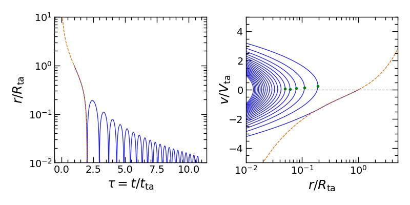

# SpheriC

**Version 0.1.2** — Published with Han (2026), *The many boundaries of the stratified dark matter halo*, [arXiv:2603.02852](http://arxiv.org/abs/2603.02852)

Python package for spherical collapse calculations including monolithic and self-similar collapse models.

## What it can do

- Predict turnaround and virial properties (time, density contrast, shell orbits) for top-hat spherical collapse in a ΛCDM cosmology
- Compute self-consistent, self-similar secondary-infall orbits and profiles (mass, density, velocity, mass flow rate) in an Einstein–de Sitter universe



## Installation

### Download the code

```bash
git clone https://github.com/Kambrian/SpheriC.git
```

or download the zip file and extract its content.

### Setup Python path

Assuming you cloned/extracted the package to `SPHERIC_DIR` (e.g., `/home/user/SpheriC`):

**Option 1 — Shell environment** (add to `.bashrc` or run before each session):

```bash
export PYTHONPATH=$SPHERIC_DIR:$PYTHONPATH
```

**Option 2 — Runtime** (add at the beginning of your Python code):

```python
import sys
SPHERIC_DIR = '/home/user/SpheriC'  # Replace with actual path
sys.path.append(SPHERIC_DIR)
```

## Quick Start

```python
from SpheriC import SCSolver, ReducedOrbit

# Monolithic spherical collapse
sc = SCSolver(OmegaM0=0.268)
delta_crit, delta_mean = sc.VirialDelta(a=1.0)
print(f"Virial overdensities at z=0: Δ_c = {delta_crit:.1f}, Δ_m = {delta_mean:.1f}")

# Self-similar secondary infall
orbit = ReducedOrbit(epsilon=0.3)
orbit.solve()
import numpy as np
x = np.logspace(-2, 0, 50)
mass_profile = orbit.GetMass(x)
density_profile = orbit.GetDensity(x)
```

For detailed examples, see [`examples/Example.ipynb`](examples/Example.ipynb).

---

## Numerical Methods

This section documents the technical implementation details corresponding to the algorithms described in Appendix B of Han (2026).

### SCSolver: Monolithic Collapse

**Perturbation dynamics:** SCSolver integrates the dimensionless expansion equation for the perturbation scale factor *a_p(t)*:

```
(da_p/dτ)² = a_p⁻¹ + ω a_p² − κ_p
```

where *τ = √Ω_{m,0} H₀ t*, *ω = Ω_{Λ,0}/Ω_{m,0}*, and *κ_p* is the energy parameter determined by the turnaround condition *a_p,ta⁻¹ + ω a_p,ta² = κ_p*.

**Turnaround mapping:** A lookup table constructed at initialization maps cosmic time *τ* to the turnaround scale factor *a_p,ta(τ)* via numerical integration of the inverse expansion rate.

**Virial radius calculation:** The virial shell is identified as the shell that turned around at **half the target cosmic time** (*τ/2*), using half its turnaround radius in perturbation coordinates:

```
a_p,vir = a_p,ta(τ/2) / 2
```

This implements the standard monolithic collapse energy argument via timing relations rather than a direct *r_vir = r_ta/2* scaling at fixed time.

### ReducedOrbit: Self-Similar Secondary Infall

**Equation of motion:** The dimensionless orbit equation is

```
d²λ/dτ² = −(π²/8) (τ^(2/3ε) / λ²) ℳ(λ/Λ) + j²/λ³
```

with turnaround boundary conditions *λ(1) = 1*, *λ'(1) = 0*, and the scale factor *Λ(τ) = τ^(2/3 + 2/9ε)*.

**Fixed-point iteration for self-consistency:**

1. **Orbit integration:** Given a trial mass profile *ℳ(x)*, integrate the orbit using RKF78
2. **Profile reconstruction:** At each sampled radius *x*, find all times *τ* where *λ(τ)/Λ(τ) = x* (crossing events). Sum their oriented contributions to obtain the new *ℳ(x)* via the discrete form of the shell-crossing sum
3. **Interpolation:** Construct *ℳ_new(x)* by **log–log linear interpolation** of the sampled points. Higher-order interpolation causes numerical instability in the iteration
4. **Convergence test:** Compute the RMS relative difference

   ```
   err = √⟨(ℳ_old/ℳ_new − 1)²⟩  over radii r > r_conv
   ```

   Stop if `err < tol_rel` (default 5%) or `max_iter` reached (default 10)

5. **Orbit extension:** Continue integrating until the **latest (innermost resolved) local maximum of *x(τ) = λ/Λ*** falls below *r_conv*, ensuring all shells contributing mass outside *r_conv* have been captured

### RKF78 Integrators

Both `RKF78infall` and `RKF78reflect` implement embedded Runge–Kutta–Fehlberg 7(8) pairs with adaptive timestepping by default and an optional fixed-step mode. They provide two alternative regularization strategies for the central singularity where the radial acceleration diverges as *λ → 0*.

**Error control:** A timestep is accepted when the **infinity norm** of the component-wise scaled errors satisfies

```
max(|err| / atol) ≤ 1
```

where `atol` is the absolute tolerance vector (default `[1e-4, 1e-4]` for *[λ, dλ/dτ]*). Accepted steps with small errors are enlarged; rejected steps are reduced following the standard scaling `h_new = h × (0.8/δ)^(1/7)`, subject to prescribed minimum and maximum timestep limits.

**RKF78infall** (used when *j > 0*): Regularizes the singularity by retaining a small centrifugal term *j²/λ³*, which holds the orbit away from the origin.

**RKF78reflect** (used when *j = 0*): Alternative regularization for strictly radial orbits. A reflecting boundary at a negligible radius bounces the shell back:

- **Fixed timestep mode:** Reflects when the proposed position crosses zero (*λ_old > 0* and *λ_new < 0*)
- **Adaptive timestep mode:** Reflects when the position falls within `atol` of the origin (*λ < atol*) **and** the velocity is inward (*dλ/dτ < 0*)

Upon reflection, the radial velocity is sign-reversed and a time correction is applied.

These are alternative regularization strategies for the same numerical divergence. The finite-*j* calculation modifies the radial equation of motion and approaches the radial solution only as *j* tends to zero; users should verify convergence with respect to either *j* (centrifugal regularization) or the reflection tolerance (boundary regularization).

### Profile Evaluation

**Crossing detection:** For a requested radius *x*, the code finds all times *τ_i* where *λ(τ)/Λ(τ) = x* using linear interpolation (default) or cubic spline root-finding (optional, for smoother derivatives).

**Mass profile *ℳ(x)*:** Sum the oriented crossings weighted by *τ_i^(−2/3ε)*.

**Mass derivative *ℳ'(x)*:** Sum the Jacobian-weighted contributions *1 / [τ^(1+2/3ε) |λ'/λ − Λ'/Λ| x]* at each crossing.

**Density *ρ(x)*:** *ℳ'(x) / (3x²)*.

**Mass flow rate *μ(x)*:** Either from the profile derivative form or equivalently from the crossing-weighted velocity sum.

**Mean velocity *v̄(x)*:** *μ(x) / ℳ'(x)*.

### Caustic and Depletion Identification

**`locate_bounds()`:** Identifies and stores indices in the orbit arrays for pericentres (`ind_peri`), apocentres (`ind_apo`), and caustics (`ind_caustic`). Pericentres and apocentres are identified from the radial orbit, while caustics are the local maxima of *x(τ) = λ/Λ* found with `scipy.signal.argrelextrema(..., np.greater)`.

**`locate_depletion()`:** Stores the scaled radius, time, mass, and density of the **first (outermost) caustic** in instance attributes `x_id`, `tau_id`, `mu_id`, `rho_id`, and `lambd_id`. In the idealized self-similar model, this first caustic coincides with both the splashback and depletion radii.

---

## Parameters Reference

| Parameter        | Default | Type  | Description |
|------------------|---------|-------|-------------|
| **ReducedOrbit** |         |       | |
| `epsilon`        | 0.3     | float | Initial perturbation slope: *δ_i ∝ M_i^(−ε)* |
| `mu0`            | `lambda x: x` | function | Initial guess for *ℳ(x)* (default: linear) |
| `j`              | 1e-2    | float | Reduced angular momentum *J/(r_ta² / t_ta)*; set to 0 for purely radial |
| `tol_rel`        | 5e-2    | float | RMS relative convergence tolerance for mass profile |
| `rconv`          | 1e-3    | float | Inner radial cutoff (units of *R_ta*) |
| `max_iter`       | 10      | int   | Maximum fixed-point iterations |
| `n_peri_min`     | 20      | int   | Minimum pericentre passages to integrate |
| `atol`           | 1e-4    | float | Absolute tolerance in *λ* and *dλ/dτ* |
| `max_timestep`   | 0.01    | float | Maximum RKF78 timestep for `integrate()`; fixed at 0.01 in `solve()` |
| **SCSolver**     |         |       | |
| `OmegaM0`        | —       | float | Present-day matter density parameter |
| `OmegaL0`        | `1 − OmegaM0` | float | Present-day dark energy density (default: flat universe) |
| `a_max`          | 1.0     | float | Maximum scale factor for lookup table (only required for Λ=0 universes) |

---

## Citation

If you use this code in your research, please cite:

**Han, J.** (2026). *The many boundaries of the stratified dark matter halo.* [arXiv:2603.02852](http://arxiv.org/abs/2603.02852)

---

## Contact

**Jiaxin Han**  
jiaxin.han@sjtu.edu.cn

---

## Version History

- **v0.1.2** (2026) — Initial release accompanying Han (2026)
